# 前言

此系列介绍我当前使用的设备、一些实用软件与环境、各类配置与做的美化（本文）。希望能给到一些启发。

我想在美化部分之外的部分 主要讲的是一种 使用这台电脑的 工作流 这种感觉。一种“用电脑的思路”。

所以虽然这些部分理论上也是“软件”，但被我从软件篇里分到这里了。

有关 Pi Agent 的介绍决定日后写一篇关于我的 Pi 插件 / 使用经验的文章。

有关 WSL，由于近期都在用 pwn.college 的远程环境，自从参与招新赛之后本地的 WSL 没有什么发展，基本上变成了用来编译计导课 C 代码的环境...几个月后也许会更加有话说。

正如难绷视频 [我不写代码，我一辈子都在配置 Emacs](https://www.bilibili.com/video/BV1Xse263E4V/?p=2) 所言：

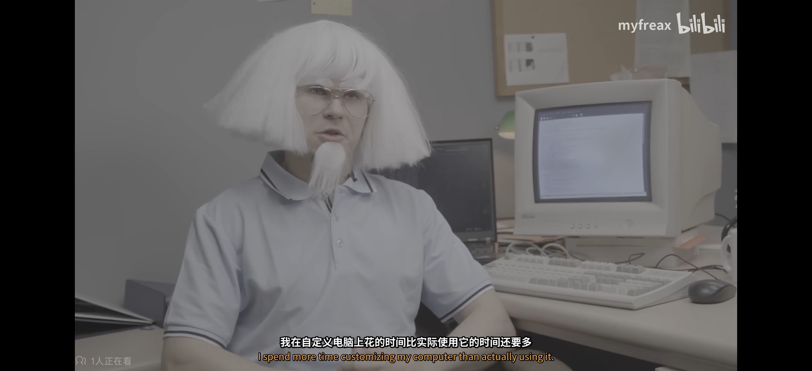



“桌面美化” 在互联网上（尤指 reddit 社区的 unixporn 板块：[r/unixporn](https://www.reddit.com/r/unixporn/)）被称之为 "rice / ricing"。由来：

```
“rice”这个称呼在桌面美化圈里，其实是一段从汽车改装文化里“继承”来的历史，背后还带着一层不太光彩的过往。

🚗 起源：汽车圈里的“Rice Burner”

这个词最初来自20世纪后半叶的美国汽车改装圈。当时一些价格低廉、以外观视觉改装为主（比如夸张的尾翼、霓虹灯、张扬的涂装），但性能提升有限的亚洲进口车（主要是日本车），被带有种族歧视色彩地贬称为“Rice Burner”（煮饭机）。给车做这种风格改装的行为，就被叫做“ricing”。

🔄 演变：从贬义词到“后天缩写”

为了淡化这个词的歧视色彩，汽车圈后来给它安上了一个听起来很专业的“后天缩写（Backronym）”：Race Inspired Cosmetic Enhancement（赛车灵感的外观强化）。这个新定义强调的是一种“重外观、轻性能”的改装哲学，从而完成了从纯粹贬义到一种特定改装风格的语义转换。

💻 跨界：从改装车到改装桌面

Linux/Unix社区（尤其是r/unixporn板块）的爱好者们，把这种“重度视觉定制、追求极致外观，实用性可能退居其次”的精神，完美移植到了操作系统桌面上。他们花大量时间调整窗口管理器、主题、图标、终端配色等，把桌面改得极具个人风格，这种行为便直接借用了汽车圈的“ricing”一词。

（UnixPorn 中的 Porn 是一种在 Reddit 上广泛的命名后缀，大概可以理解为“...的极致视觉图片”，比如说有 FoodPorn、EarthPorn 这种板块...）

所以，当你看到有人说“rice了一个桌面”，就相当于在说“像改装车一样，把我的桌面狠狠‘装修’了一番”。不过需要了解的是，由于其词源本身带有种族色彩，至今仍有一些人对此感到不适，而选择用“theming”（主题化）等更中性的词来替代。
```

此外，由于许多程序的配置文件往往是以 "." 开头的（这源自 Linux 中以 "." 开头的文件一般被视为隐藏的文件，你可以在 home 目录用 `ls -a` 看到；或者在 Windows 上，你也会看到用户目录下有一堆 "." 开头的隐藏文件），这些“配置文件分享”的仓库 / 项目常被称作 `dotfile`。

你可以通过搜索 `ricing / dotfile` 在互联网上找到许多可供美化 / 配置参考的样例。

例如这里有一些本文参考的例子：

[https://github.com/Vabolos/windots](https://github.com/Vabolos/windots)

[https://github.com/ashish0kumar/dotfiles](https://github.com/ashish0kumar/dotfiles)



# 画廊

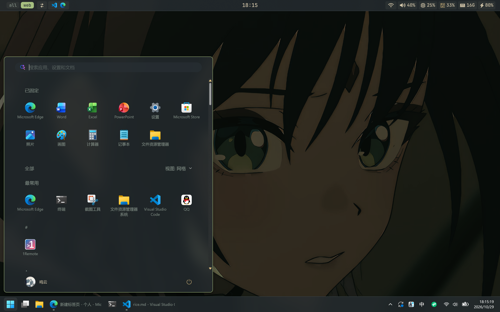

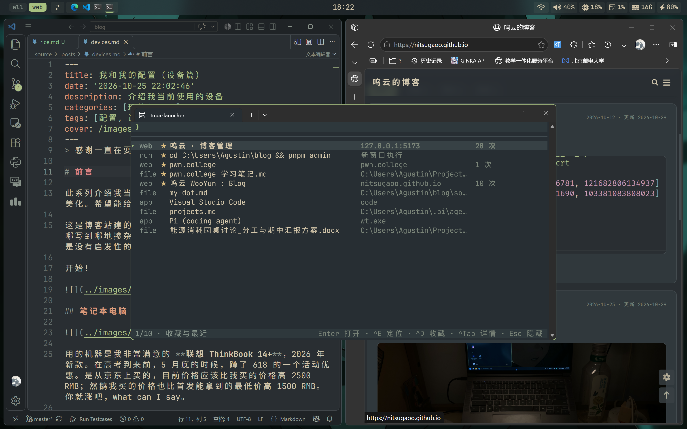

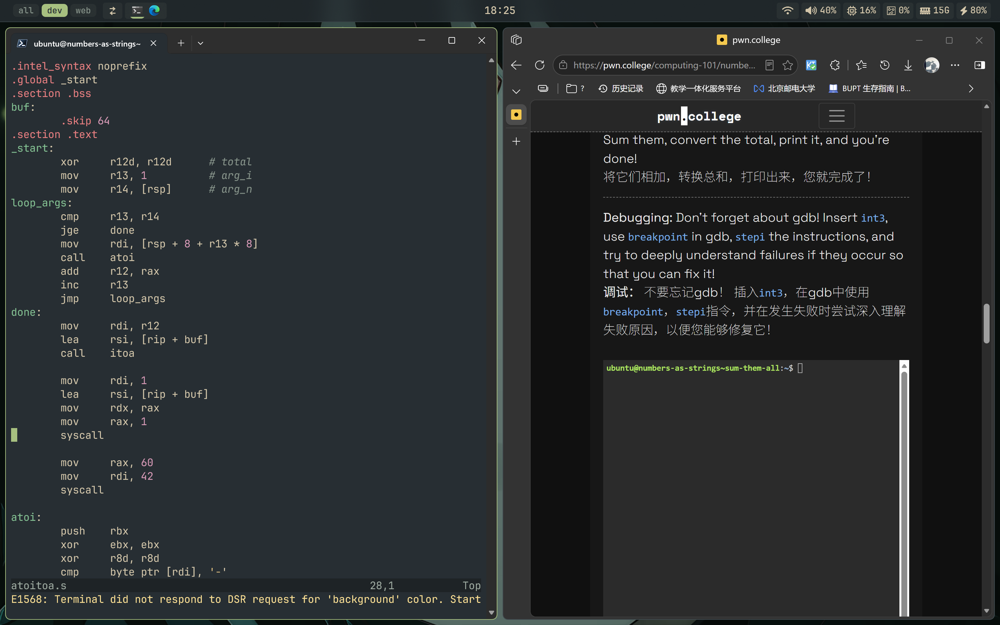

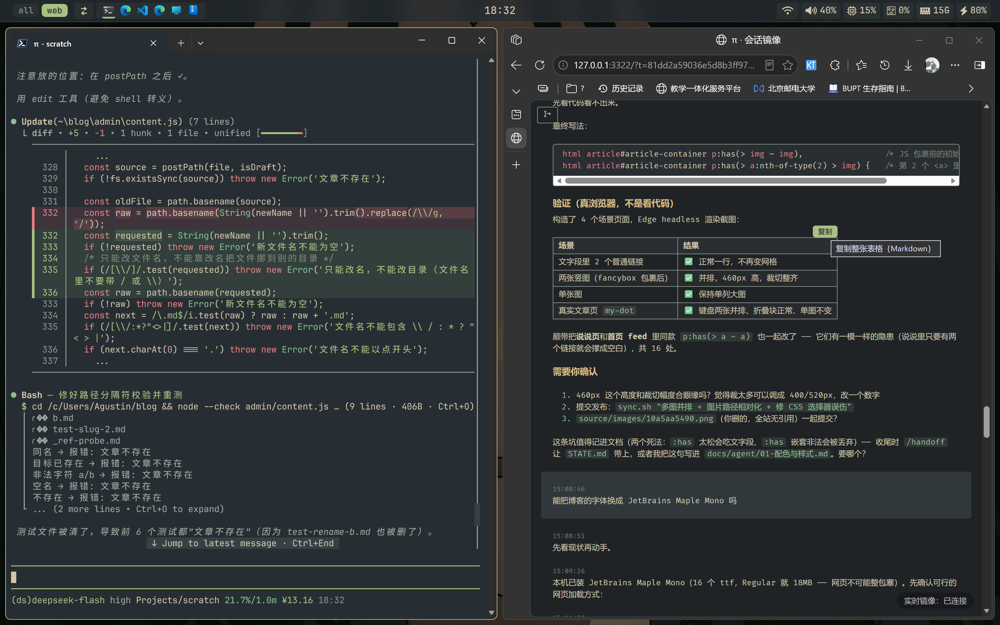




<video controls src="../videos/VID_20261030111335804.mp4" title="Title"></video>

GIF Here: 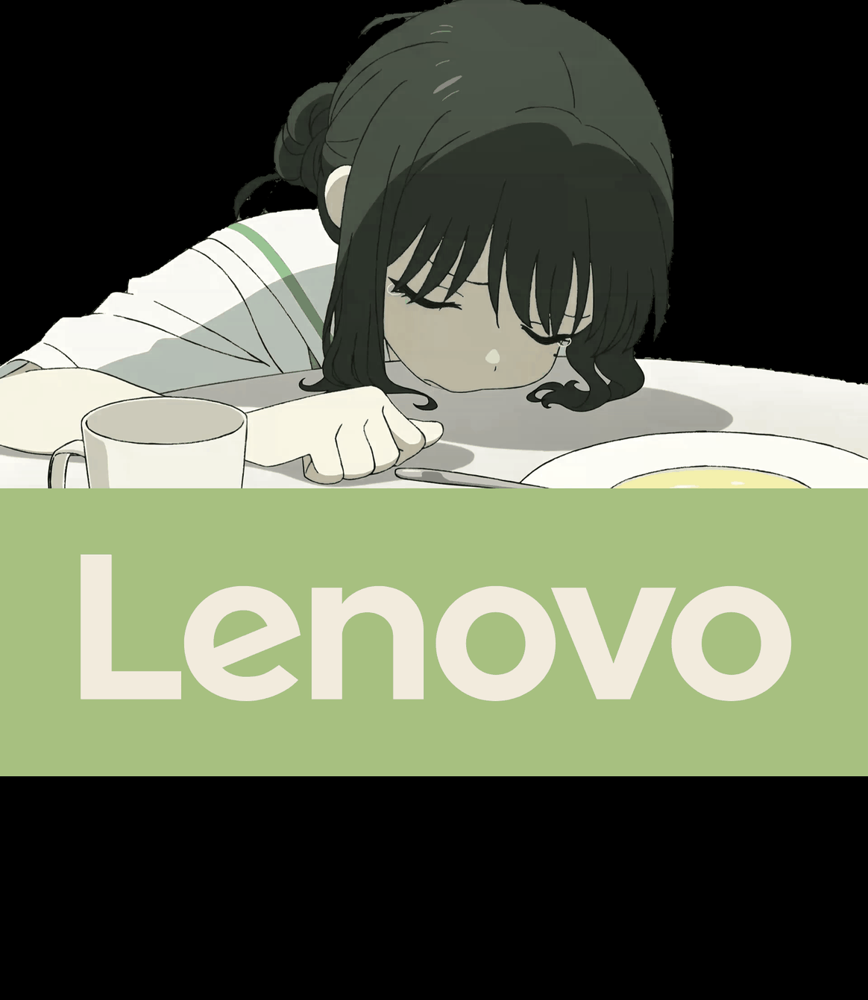



# 概述

- 系统：Windows 11
- 配色方案：[EverForest Colorscheme](https://everforest.vercel.app/)，以绿色为主题色的低饱和度护眼主题
- 字体：微软雅黑，[~~FiraCode~~](https://github.com/tonsky/FiraCode) [Jetbrains Maple Mono](https://github.com/SpaceTimee/Fusion-JetBrainsMapleMono)，融合 Jetbrains Mono 与 Maple Mono 的优秀等宽字体方案，中英文 2:1 与可变字体；不出意外的话，就是你现在在这个网页上看到的字体。
- 动态壁纸：Wallpaper Engine
- 窗口管理器：[GlazeWM](https://github.com/glzr-io/glazewm)，Windows 上的 i3 式平铺窗口管理器
- 状态栏：[YASB](https://github.com/amnweb/yasb)，一款高度可配置的 Windows 状态栏，使用 Python 编写，支持多种小部件、便捷的主题定制以及深度自定义。
- App 启动器：[tupa-launcher](https://github.com/NitsugaoO/tupa-launcher)，自己 vibe 出来的 `TUi PAllete`
- Agent: [Pi Coding Agent](https://pi.dev/)，保持极简与高可拓展性的 TUI Agent
- 输入法：微信输入法
- 终端：Windows Terminal 和 Powershell，应该暂时不会扎进换终端的深坑之中（）
- 文本编辑器：VSCode，尝试上手 neovim 中
- 浏览器：Microsoft Edge，其实有点想换掉。
- WSL: Ubuntu 24.04

你应该可以在 [这个仓库](https://github.com/NitsugaoO/windows-everforest-rice) 找到本文提到的各个配置文件的成品（和本文没有提到的配置文件...让 AI 整理项目是一门学问）。如果没有的话可以在评论说一声~~或者直接在 QQ / 微信上拷问我~~。

接下来介绍一下一些有趣的部分。

# 美化

用到了 [WindHawk](https://windhawk.net/) 软件，与其中的 5 个 Mod。

除了 `Middle click to close on the taskbar` （在任务栏上中键关闭窗口），剩余的 4 个 Mod 下文会提及。

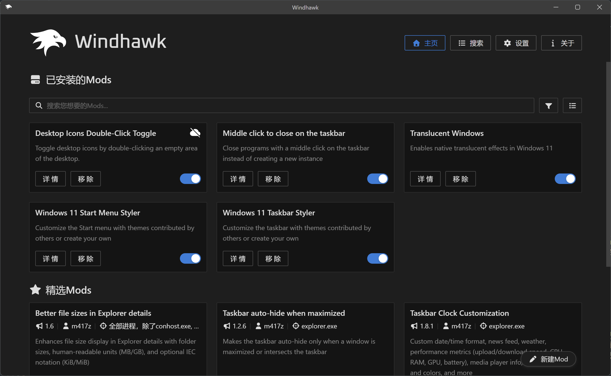



WindHawk 是由 RaMMicHaeL (m417z) 开发的“模块化代码注入式 Windows 定制平台”。简单来说可以通过下 Mod（当然也可以写 Mod）来注入式地修改系统，比如把资源管理器变成亚克力的，把开始菜单改回 Win7 的，诸如此类。

m417z 是著名的 [7+ Taskbar Tweaker (7TT)](https://ramensoftware.com/7-taskbar-tweaker) 软件的作者。实际上 7TT 在 Win11 上已经不被支持，WindHawk 正是官网声明的精神续作。大部分的 7TT 的功能都有对应的 m417z 亲自写的 WindHawk Mod。



## 桌面
动态壁纸是 [这个](https://steamcommunity.com/sharedfiles/filedetails/?id=3776452884)，加上了“翡翠”的“图片筛选器”（大概就是滤镜的意思），拉满，然后把亮度和饱和度拉低以适应主题。但比较耗电，所以在 Wallpaper Engine 里面设置了离电时关闭。

这个时候背景就变成了 EverForest 里面最深一档的纯色背景。

我的桌面完全用来放杂乱的临时文件，App 都是用开始菜单或者 Launcher 打开的。在 WindHawk 里装了一个叫做 `Desktop Icons Double-Click Toggle` 的 Mod，以实现双击桌面切换桌面图标的显示；然后让 Agent 改了一下，开机的时候自动隐藏，这样就不会影响我欣赏酒寄彩叶的盛世美颜了。

## 开始菜单 / 任务栏

使用了 WindHawk 中的两个 styler Mod。

除了画廊里的展示效果好像也没什么好说的（）

我任务栏一般开着居左加上尽量不合并，由于有 YASB 所以开了自动隐藏。开始菜单选网格。

## 窗口描边 / 透明化

窗口描边目前用的是 GlazeWM 自带的聚焦窗口描边，不过如果只是想要描边效果，更推荐 [Tacky Borders](https://github.com/luke-you/tacky-borders)。如果我记得没错的话后者是支持给开始菜单、QQ 都加上描边的，但是前者不支持给开始菜单描边（我现在是用 WindHawk 改开始菜单给加上了描边），且由于 QQ 在这个边缘贴靠收起的“经典模式”下和 GlazeWM 不是很兼容，所以 QQ 被设置为了不被 GlazeWM 接管，也就没有效果了。

透明化（应该是亚克力，你也可以选其它的效果，比如模糊或者 Win11 的那个云母）用了 `Translucent Windows` Mod，不过只用在了 YASB 上：YASB 似乎没有内置的透明支持？

很好的一点是打开系统的节能模式之后这些透明效果都会关闭。

## 状态栏

YASB (Yet Another Status Bar)。

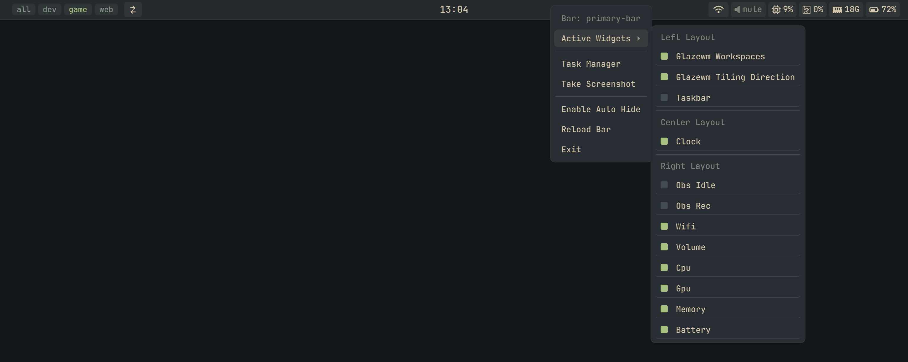

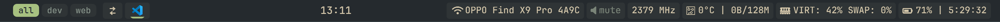

现在用的是用 Agent 改过好多版的版本。不敢想没有 Agent 的话我需要花多少时间和代价才能做成这样...

而且即便如此，回想起这个调的过程，暑假刚开始的时候 DeepSeek Flash 还没有识图能力...依然是地狱啊。

总之最后做成了自己非常满意的样子。简单来说：

1. 大改了自带的 CPU / GPU / RAM / Battery 组件。统一把默认左键打开的显示状态波线图的窗口都去掉了，我的设计思路基本上是一个 HUD，平时根本就不会去点；右键显示的详细信息保留了，抬头就能看到电脑还有多久才会没电确实很好用。图标应该是从系统的字体和 JetBrains Mono 的字体里掏出来的。随着占用率 / 剩余电量的不同会有红橙黄的变化，默认情况下就是 EverForest 的米白色。不过似乎由于这个硬件比较新，暂时测不出温度？也不错，反正眼不见心不烦了。
2. 大改（感觉基本是重写）了自带的 WiFi 组件。
3. 音量组件似乎没怎么改？只记得把左键点出来的音量滑块关掉了（我没记错的话应该是支持分别调各个应用的音量的，这个其实挺好用），鼠标 hover 在上面的时候可以滚轮调音量。
4. 日历调了好久也不满意，也被我关掉了。
5. 左侧有 GlazeWM 联动的工作区显示和迷你任务栏。
6. 做了一个 OBS 的组件，检测到 OBS 在后台的时候会显示当前录制状态，可以左键开始 / 暂停录制，右键结束录制并打开输出视频所在文件夹。
7. 主题色、按钮的颜色和胶囊的样式，都调了好久...

不知道最终有没有修改 YASB 本体的功能（）我记得好像为了实现 CPU 图标和文字一起变色是有改的。如果想要用这套配置最好让你的 Agent 检查一下。

# 窗口管理器

GlazeWM。其实网络上也挺多教程的。简单来说，软件会在打开新窗口的时候进行自动分配位置和大小。比如说打开了一个终端，再打开一个，就会自动左右分屏这样。

在 Linux 上有很多窗口管理器吧。Windows 上这款就比较稳定好用了。当然还有别的，你可以自行探索一下。

为了推荐这个软件（或者说，这种快捷的管理窗口的方式），我想尽力讲一讲一些大概的功能：

1. 可以拖动窗口，改变位置；
2. 拖动窗口变宽改变大小的时候都会自动平铺，把左边的窗口变窄，右边就会自动变宽填充；
3. 设计思路上，窗口大致分为三层：平铺层、全屏层，以及不被 GlazeWM 接管的层。比如说你可以把开了 CTF 赛题的网页（用快捷键 Alt + F）全屏放在后面，前面开着 VSCode 和 WSL 的分屏，然后再（用快捷键 Alt + Space 在全屏层和平铺层切换）。平铺层的窗口都是一个组，你点任务栏打开其中一个窗口的时候（一般）都会把那一组都打开；
4. 工作区功能，平替了 Win11 自带的多桌面，不过总之就是感觉会更加灵敏；
5. 各种切换窗口 / 移动窗口位置 / 在工作区之间移动窗口 / 改变窗口大小 等等操作，基本上都有快捷键覆盖。 ALt 键最有用的一集。`alt + enter` 打开终端真是很方便。Windows 居然没有默认的 `Win` 开头的这种打开 Windows Terminal 的键吗，我觉得很诡异。

哎呀我根本讲不出来这种好用的感觉。总之推荐你试一下。

我的配置基本上就是

1. 去掉了一些冲突的快捷键（比如说 alt + 上下，和 VSCode 里的移动代码行的快捷键就冲突了。直接去掉了，需要的时候就用 alt + j / k。并没有加什么快捷键）；
2. 加上了一些需要被 ignore 的或者 set-floating 的窗口规则（比如 QQ、Clash Party、Windhawk 是 ignore，Explorer 窗口和 Nanazip 是 set-floating 自动居中放置）；
3. 把描边改成绿色、加上了屏幕边缘和窗口之间的间距。

此外，Windows 自带的窗口贴靠 / 分屏功能都要在设置里关掉，不然会感觉很奇怪。一定要记得这一点，不要因为两种窗口管理模式的冲突而被劝退了。



高考完 8 月份的时候去装 Agent，第一个装的是 Reasonix。因为我觉得：既然都用 Windows 系统了，还是老老实实 GUI 吧。结果 Reasonix 变成了一坨 Vibe 出来的屎山，10 个小版本都没有修好简单的会话渲染问题，我没招了，就开始搞 Pi。TUI 真好用。

然后看那个 Omarchy 系统火了，简单尝试了一下；结合暑假刚开始很豪地给旧电脑装了一个别人配置好的 Arch Linux，感觉窗口管理器这种东西才是我真正想要的，所以找到了 GlazeWM。

在调键位的时候却又感到 Windows 果然不是以键盘控制为目标的。很多软件依然不太能够用键盘全盘控制，但已经折腾了很久了，我也只能先接受这种一点点的膈应的感觉了。

怎么说呢。感谢 AI 大人吧。“让操作变得更顺手”的终点，大概直到 AI 能读心的时候就会到来。期待那一天。



# 应用启动器

隆重介绍 TUPA Luancher！

[Github](https://github.com/NitsugaoO/tupa-launcher)

描述全是 AI 写的。目前看起来比较像施工现场。大概等我很久以后有空了会来好好写 README 的...

虽然自己用的很爽，但是如果想要发布成什么成果的话还有很长的路要走。有生之年会去这么做的。

简单来说，这是一个 Rust 写的 TUI App Launcher。

我一直觉得像什么 Utools 这种工具都太臃肿了。后来用 Powertoys 的 CmdPallete，感觉也不好用，而且拓展性太差了。明明 TUI 这种紧凑列表才是最适合做 App Launcher 的啊！还有做个毫无软用的二维码扫描插件和有一点用的单位换算插件并不能证明你们所谓的高可拓展性啊...总之我受不了了，Vibe 启动。

大改写一下设计思路。

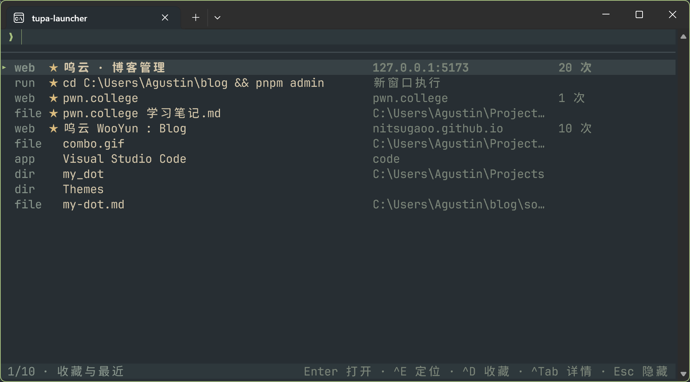
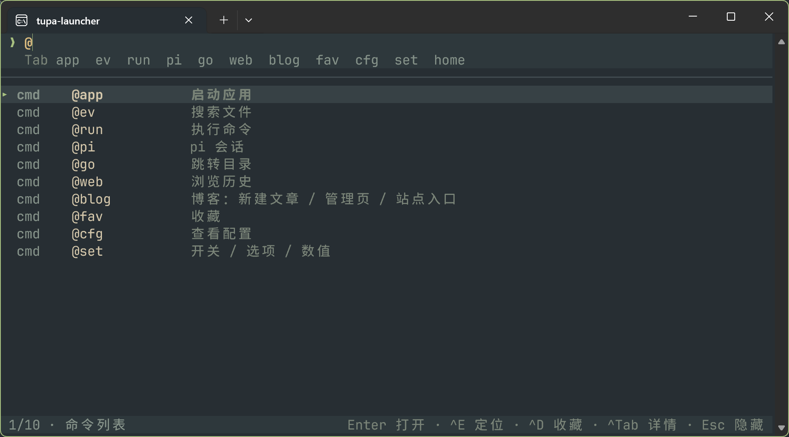
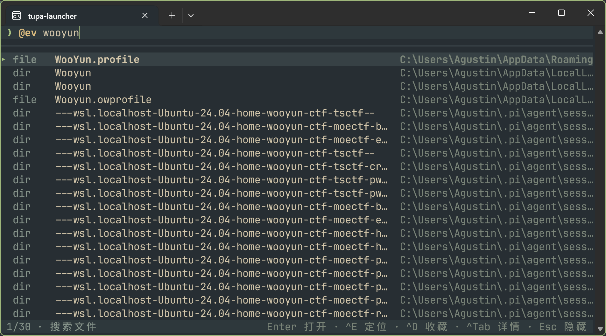
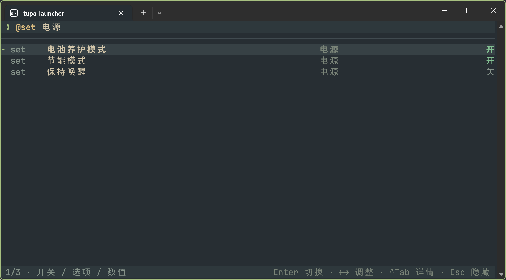

基本架构：
1. ``alt + ` `` 呼出 tupa。
2. 开屏显示收藏信息和历史记录
3. 输入 `@` 开始打命令，支持 `Tab` 自动补全
4. 命令支持参数，例如 `@run:admin` 以管理员权限运行命令。

比较好用的命令 (Provider) 有
1. `ev` 调用 Everything 搜索
2. `web` 查找网页浏览历史
3. `go`  调用 Zoxide 智能打开路径等等
4. `set` 一些快速的开关，比如开关 nosleep、节能模式（会同时打开系统的节能模式（用了很原始的键盘模拟的方式...根本没有这种接口...）和 Lenovo Vantage 的静音省电模式（明明应该是后者更难一点吧！愚蠢的巨硬，做接口给我做好的诶！））、电池节能模式（如果要出门很久的话就把电池的 80% 上限保护关掉充满一点。）

# Pi Agent
决定另写一篇文章详细介绍。施工中。

# 后记

折腾是好奇心是人的本能。感谢一直都在不顾一切地折腾电脑的自己，这一路上我收获了许多。
